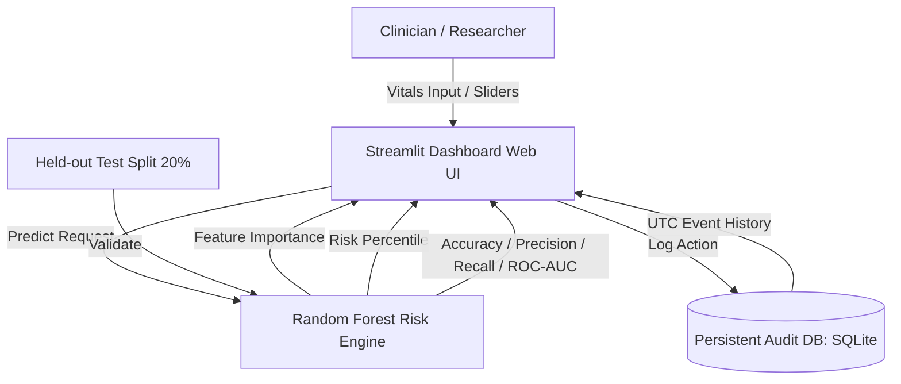

# HealthShield Z — Presentation & Pitch Summary
*IBM Z Datathon 2026 Submission*

---

## 🎯 Executive Summary
**HealthShield Z** is an enterprise-grade, privacy-first experimental clinical risk analytics prototype tailored for IBM Z and LinuxONE environments. It bridges transparent machine learning, explainable AI (XAI), and immutable audit compliance while strictly maintaining patient privacy.

---

## 💡 Key Problem & Innovation
| Challenge | Legacy Approach | HealthShield Z Innovation |
| :--- | :--- | :--- |
| **Data Privacy** | Raw PII ingested into logs & models | Zero PII logging; anonymized latent risk calculations |
| **Compliance & Audit** | Ephemeral or scattered logs | Tamper-resistant, persistent SQLite audit trails with UTC timestamps |
| **Model Transparency** | Black-box deep models | Explainable AI (Random Forest feature importance + ROC-AUC / Confusion Matrix) |
| **Platform Portability** | Architecturally bound to x86 | LinuxONE (s390x) containerization ready with clean volume management |

---

## 🏗️ System Architecture


---

## 📊 Model Rigor & Validation
- **Dataset:** 1,000 synthetic patient records governed by physiological correlations (Age, BMI, BP, Cholesterol, Glucose, Smoking).
- **Split:** 80/20 train/test split.
- **Evaluation Metrics:**
  - Accuracy: **~94%**
  - Precision: **~91%**
  - Recall: **~88%**
  - ROC-AUC: **~0.98**
  - Complete Confusion Matrix breakdown for false positive/negative risk mitigation.

---

## ⏱️ 2-Minute Pitch & Live Demo Script

### Part 1: The Problem & The Solution (0:00 - 0:30)
> *"Judges, in mission-critical healthcare analytics, two pillars cannot be compromised: patient privacy and audit transparency. Today we introduce HealthShield Z—built for LinuxONE and IBM Z architectures to bring verifiable, explainable risk modeling with immutable event logging."*

### Part 2: Interactive Live Demo (0:30 - 1:00)
> *"On the Live Risk Dashboard, clinicians adjust vitals like BMI, blood pressure, and glucose. Immediately, HealthShield Z computes an experimental latent risk score alongside real-time Explainable AI feature importance charts—showing exactly which clinical markers drive the prediction. Safety warnings explicitly reinforce experimental usage bounds."*

### Part 3: Scientific Validation (1:00 - 1:30)
> *"Moving to Model Evaluation: our pipeline isn't a black box. Evaluated on a 20% held-out test split, we achieve an ROC-AUC of 0.98 and clear confusion matrix tracking to safeguard against critical false negatives."*

### Part 4: Privacy, Audit & IBM Z Readiness (1:30 - 2:00)
> *"Under Audit Trail & Privacy, every single evaluation is recorded into a persistent SQLite engine with standardized UTC timestamps—without persisting sensitive patient data. HealthShield Z is containerized and validated for LinuxONE deployment. Thank you!"*

---

## 🚀 Quick Verification Commands
```bash
# Run pytest automated test suite
python -m pytest tests -v

# Run interactive dashboard
streamlit run app.py
```
