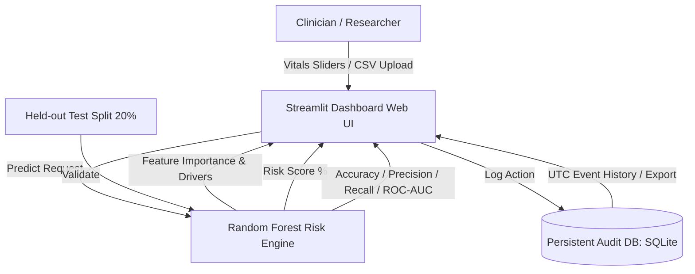

# HealthShield Z — Experimental Risk Analytics Prototype

[](https://share.streamlit.io/deploy?repository=Ram071/HealthShield-Z&branch=main&mainModule=app.py)
[](https://ram071.github.io/HealthShield-Z/)
[](https://github.com/Ram071/HealthShield-Z/actions)
[](LICENSE)

HealthShield Z is an enterprise-grade, privacy-first experimental clinical analytics prototype built for the **IBM Z Datathon 2026**, optimized for LinuxONE and IBM Z architectures.

---

## 🌐 Live Deployments

### Option 1: 1-Click Streamlit Community Cloud (Recommended)
Deploy and host this app online in 30 seconds for free:  
👉 **[Click Here to 1-Click Deploy on Streamlit Cloud](https://share.streamlit.io/deploy?repository=Ram071/HealthShield-Z&branch=main&mainModule=app.py)**

### Option 2: Live GitHub Pages Web Demo (WebAssembly)
An in-browser WebAssembly version powered by Pyodide and stlite:  
👉 **[View Live GitHub Pages Demo](https://ram071.github.io/HealthShield-Z/)**

---

## 🏗️ System Architecture



---

## 🚀 Key Features
- **Custom CSV Dataset Support:** Upload custom patient CSVs with automatic schema validation and fallback to default 1,000 synthetic records.
- **Explainable AI (XAI):** Real-time global feature importance rankings alongside patient-specific risk factor drivers (Hypertension, Hyperglycemia, Obesity, etc.).
- **Robust Evaluation:** Precision, recall, F1, ROC-AUC (~0.98), and confusion matrix on held-out test data.
- **Persistent Audit Logging:** SQLite event logging with standardized UTC timestamps and one-click CSV audit export.
- **Privacy Safeguards:** Zero PII storage; no direct patient identifiers or raw submitted feature values persisted.
- **Automated CI/CD:** 5 comprehensive unit tests executed automatically on every GitHub push and PR.
- **IBM Z / LinuxONE Ready:** Validated Dockerfile ready for containerized execution on s390x and x86 architectures.

---

## 📂 Sample Dataset
A pre-formatted 100-row sample dataset is available in [`data/sample_patient_data.csv`](data/sample_patient_data.csv) to test the custom file uploader. You can also download it directly from the app's sidebar.

---

## 🛠️ Quickstart Guide

### 1. Local Setup
```bash
# Clone the repository
git clone https://github.com/Ram071/HealthShield-Z.git
cd HealthShield-Z

# Create virtual environment & install dependencies
python -m venv .venv
source .venv/bin/activate  # On Windows: .venv\Scripts\activate
pip install -r requirements.txt
```

### 2. Run Automated Tests
```bash
python -m pytest tests -v
```

### 3. Launch Dashboard
```bash
streamlit run app.py
```

### 4. Run with Docker (LinuxONE / Local)
```bash
docker build -t healthshield-z .
docker run -d -p 8501:8501 --name healthshield-app healthshield-z
```
